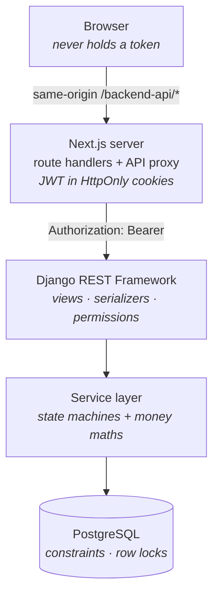

# PayoutFlow

A creator marketplace payout engine — Django 5.2 / DRF, PostgreSQL, Next.js — built around
transactional correctness, exact monetary arithmetic and data integrity under concurrent
writes. Payout processing is simulated — no payment provider integration or real money movement.

---

## Problem

A marketplace owes money to creators for completed work. Both failure directions are
expensive — paying an earning twice loses money, dropping one loses trust — and the failure
modes are concurrency and rounding rather than business rules.

- Derive an earning from a completed job: surge multiplier, tip, platform fee and post-hoc
  adjustments, exact to the cent.
- Aggregate earnings into weekly per-creator batches under a minimum-payout threshold.
- Pay an earning **at most once**, even when two admins generate in the same instant.
- Keep settled history immutable when the fee rule changes.
- Scope every read so a creator sees only their own financial data.

---

## Architecture



```text
api/   config/  settings, urls, api_urls (composes each app's router)
       apps/    core · accounts · creators · jobs · earnings · payouts · audit · dashboard
       tests/   pytest suite
web/   src/     app (routes; backend-api/* = auth + proxy) · components · lib
```

The five domain apps — `creators`, `jobs`, `earnings`, `payouts`, `audit` — share one
layout: `models · serializers · views · services · filters · urls`. `core` holds the
cross-cutting pieces: money arithmetic, permissions, error envelope, advisory locks,
pagination, logging.

---

## Key design decisions

**Invariants belong in the database, not in application code.** Every rule that must never
break is a constraint, a unique index or a lock. An application-level check loses races by
construction; a `UNIQUE` constraint does not.

**The service layer owns business logic and transaction boundaries.** `complete_job`,
`create_earning_for_completed_job`, `generate_payout_batch`, `process_payout_batch` and
`add_adjustment` are callable unchanged from HTTP, a management command or a test.

**Monetary arithmetic in Python `Decimal`; storage in PostgreSQL `NUMERIC(_, 2)`.**
Calculation is a pure function (`apps/core/money.py`) with no database access. Each
component is quantized to two decimal places with `ROUND_HALF_UP` as it is computed —
once per component, never on a total — so persisted rows satisfy `gross = surge + tip` and
`net = gross − fee + adjustments` exactly. No float enters the money path.

**Immutability by snapshot.** The applied fee percentage is copied onto each earning and
the active rule is serialized onto each batch, so editing a rule cannot restate settled
money.

**Money rolls forward.** Earnings below the payout threshold stay `PENDING` for the next
period; a failed transfer releases its earnings back to `PENDING` and records the reason.

**Generation is idempotent by database constraint.** Re-running
`generate_payouts` cannot create a second batch for a period: the unique constraint rejects
it and the command reports it. `--dry-run` reports what would be considered without
writing.

**PostgreSQL is a verified hard dependency.** `DATABASE_URL` has no default, and a
non-PostgreSQL backend raises `ImproperlyConfigured` at import time — the payout paths rely
on `SELECT … FOR UPDATE`, partial unique indexes and advisory locks.

**Sessions stay server-side.** The JWT lives in `HttpOnly; Secure; SameSite=Lax` cookies
that the Next.js proxy attaches and refreshes, so no token reaches client JavaScript.
Logout blacklists the refresh token; `BLACKLIST_AFTER_ROTATION` retires each rotated one.

**Isolation lives in the queryset, not the view body.** Scoping is applied in
`get_queryset()`, so another creator's row is absent rather than forbidden — 404 rather
than 403, and not enumerable.

---

## Core engineering concepts

Concurrency is enforced by the database and verified by tests that drive **real parallel
transactions** (`tests/test_concurrency.py`).

| Guarantee | Mechanism |
|---|---|
| One batch per period | `UNIQUE (period_start, period_end)`; the loser of a race gets `409 PAYOUT_BATCH_ALREADY_EXISTS` |
| An earning is paid at most once | One nullable FK from `Earning` to `CreatorPayout`, `PENDING → INCLUDED → PAID`, eligible rows selected `FOR UPDATE` |
| One earning per job | `Earning.job` is a `OneToOneField` with `on_delete=PROTECT` |
| One payout per creator per batch | `UNIQUE (payout_batch, creator)` |
| Exactly one active payout rule | Partial unique index on `is_active` (`WHERE is_active`), plus `pg_advisory_xact_lock` around activation |
| A batch is processed once | Status re-checked under `SELECT … FOR UPDATE` |
| No negative money · surge ≥ 1.00 · fee 0–100% | `CHECK` constraints on job, earning, payout and rule columns |

**Transaction boundary.** `generate_payout_batch()` runs in a single
`transaction.atomic()`: validate the period, snapshot the active rule, select eligible
earnings `FOR UPDATE`, group and sum per creator, apply the threshold, write one
`CreatorPayout` each, flip `DRAFT → READY`. Any failure rolls the whole batch back — no
partial state to reconcile.

**Error contract.** Business failures carry a stable code
(`PAYOUT_BATCH_ALREADY_PROCESSED`, `NO_ACTIVE_PAYOUT_RULE`, …) through one DRF exception
handler, so clients branch on codes rather than on prose.

**Audit trail.** Service-layer actions append to an `AuditLog` exposed read-only over the
API. Metadata is sanitized before it is persisted: secret-like keys dropped, payout
accounts and phone numbers masked.

**Readiness.** `/api/health/` round-trips a query and returns 503 when the database is
unreachable — the Docker `HEALTHCHECK` and Compose's `condition: service_healthy` gate on it.

**Tests.** 99 tests covering the arithmetic and period boundaries, auth, RBAC, isolation,
threshold roll-over, rule immutability, the guarantees above under real contention, and a
query-count regression guarding the batch-list annotations. CI adds `ruff`,
`check --deploy` and a missing-migration check against PostgreSQL 16.

---

## Tech stack

**Backend** — Python 3.13 · Django 5.2 · DRF · SimpleJWT · django-filter ·
drf-spectacular · psycopg 3 · Gunicorn · WhiteNoise. Dependencies declared as PEP 735
groups in `pyproject.toml`.

**Frontend** — Next.js 16 (App Router) · React 19 · TypeScript 5 · Tailwind CSS 4 ·
TanStack Query 5.

**Data** — PostgreSQL (14+ locally; CI runs 16). **Tooling** — pytest · ruff ·
Docker Compose · GitHub Actions.

OpenAPI 3 schema at `/api/schema/`, Swagger UI at `/api/docs/`.

---

## Local setup

Python 3.13+, Node 20+, PostgreSQL 14+.

```bash
createdb payout_db

cd api
python -m venv .venv && source .venv/bin/activate   # Windows: .\.venv\Scripts\Activate.ps1
pip install --group dev
cp .env.example .env                                # SECRET_KEY and DATABASE_URL required
python manage.py migrate && python manage.py seed_data
python manage.py runserver 8000

cd ../web && npm install && cp .env.example .env.local && npm run dev
```

`seed_data` creates sample users and payout history. Remaining configuration is documented in
`api/.env.example`.

```bash
cd api && pytest && ruff check .
```

Docker Compose runs both applications. PostgreSQL stays external, so point `DATABASE_URL`
at `host.docker.internal` to reach a database on the host.

```bash
cp api/.env.example api/.env && docker compose up --build
```